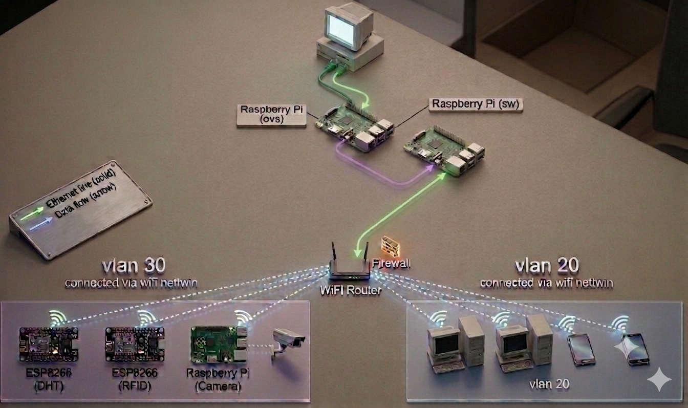

# NetTwin

**A Digital Twin Architecture for Intelligent, Fault-Tolerant IoT Networks**

## Overview

NetTwin is a Digital Twin architecture for IoT networks that combines Software-Defined Networking (SDN), real-time telemetry (MQTT), AI-based intrusion detection, and self-healing mechanisms to monitor, manage, and secure IoT infrastructure.

The system was developed as a 2nd-year Higher Cycle (2CS) engineering project at the Higher School of Computer Science (ESI-SBA), Algeria.

## Key Features

- **Digital Twin** of an IoT network (Raspberry Pi, ESP8266 nodes)
- **SDN/OpenFlow** control via Ryu controller
- **MQTT** telemetry for real-time state synchronization
- **InfluxDB + Grafana** for monitoring and visualization
- **AI-based intrusion detection** (Random Forest) for DDoS, U2R, R2L attacks
- **Self-healing** logic for fault tolerance
- **VLAN security** and network segmentation
- **Edge surveillance node** with video streaming and motion detection

## Team

- Ghrib Khouloud
- Abdennbi Lamia
- Ammi Maissara
- **Khiter Sara Nadjet** (contact: sn.khiter@esi-sba.dz)

> **Note:** This repository is maintained by Sara Khiter for documentation and demonstration purposes. The project was a collaborative effort by the four team members listed above. Original contributions are acknowledged collectively.

## Supervisors

- **Dr. Serhane Ousama** (project supervisor)

## Demo Video

[Watch the demo](https://youtu.be/TRUVGbu3Qao) *(replace with your actual link)*

## Documentation

[Technical overview](docs/overview.md) — summary of the architecture and key components.

## Technologies Used

- **Networking:** SDN, OpenFlow, Ryu, VLAN
- **IoT:** Raspberry Pi, ESP8266, MQTT
- **Monitoring:** InfluxDB, Grafana
- **AI/ML:** Random Forest, scikit-learn
- **Edge:** picamera2, OpenCV, Flask
- **Languages:** Python, JavaScript
